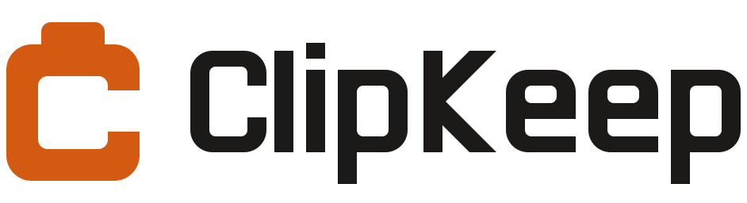

<h1 align="center">
  <picture>
    <source media="(prefers-color-scheme: dark)" srcset="docs/brand/clipkeep-horizontal-color-on-dark.svg">
    
  </picture>
</h1>

<p align="center">
  <a href="https://github.com/HBL-LL/ClipKeep/releases/latest"></a>
  <a href="https://github.com/HBL-LL/ClipKeep/releases"></a>
  
  
  
  <a href="LICENSE"></a>
</p>

A small menu bar clipboard manager for macOS 14+.

## Install

Works on Apple Silicon and Intel Macs running macOS 14 or later.

### Quickest: one line in Terminal

Open Terminal and paste:

```bash
curl -fsSL https://raw.githubusercontent.com/HBL-LL/ClipKeep/main/install.sh | bash
```

It downloads the latest release, checks its checksum and signature, puts ClipKeep in Applications and opens it, with no security warning.

### Or with the DMG

1. Download `ClipKeep.dmg` from the [latest release](https://github.com/HBL-LL/ClipKeep/releases/latest), open it, and drag **ClipKeep** onto **Applications**.
2. Open ClipKeep. ClipKeep isn't signed with a paid Apple Developer ID, so macOS says it "could not verify" it. Click **Done**.
3. Go to System Settings → Privacy & Security, scroll down, click **Open Anyway** next to ClipKeep, and enter your password.
4. Open ClipKeep again and confirm. You only have to do this once.

ClipKeep lives in the menu bar, with no Dock icon. To let it paste for you, allow it in System Settings → Privacy & Security → **Accessibility**.

## Updates

ClipKeep checks GitHub for a new release once a day (Settings → Updates; you can turn this off). You can also click **Check for Updates** there, or right-click the menu bar icon. When a new version is out, ClipKeep shows what changed and can download, check, and install it, then relaunch.

ClipKeep has to be somewhere it can replace itself, such as your Applications folder. After an update, macOS may ask you to allow Accessibility access again.

## Use it

- **Click the menu bar icon** to open your clipboard history under it, or press **⇧⌘V** to open it near the mouse.
- **Right-click the icon** for Pause Recording, Clear History, Check for Updates, Settings and Quit. In the history window, the **trash** clears your history (pinned clips are kept) and the **gear** opens Settings. The shortcut hints at the bottom are buttons too.
- Type to search. Use **↑ ↓** to move, **↩** or a click to paste, **⌘1–⌘9** to paste one of the first nine clips.
- **⌘P** pins a clip (pinned clips are never trimmed), **⌘⌫** deletes one, **esc** closes the window.
- Copied images (screenshots, pictures) are saved too and show as thumbnails. Type "image" to find them.
- Settings has four tabs:
  - **General:** launch at login, history size, saving images, Clear History.
  - **Pasting:** automatic or plain-text pasting, and whether Accessibility access is allowed.
  - **Privacy:** skipping passwords and apps to ignore.
  - **Updates:** automatic checks, Check for Updates, and a link to the release notes.

To paste for you, ClipKeep needs **Accessibility** access (System Settings → Privacy & Security → Accessibility). Without it, the clip is copied and you press ⌘V yourself.

## How it works

| Part | File | What it does |
| --- | --- | --- |
| Clipboard watcher | `ClipboardMonitor.swift` | Checks the clipboard's change counter every 0.5 s. Saves plain text plus rich text (RTF, or HTML converted to RTF); when a copy has no text, saves its image (up to 50 MB). Skips password-manager content, ignored apps, blank text, file copies' icons and its own pastes. |
| History | `ClipStore.swift` | Newest first; copying the same text or image again moves it to the top. Keeps the last N unpinned clips. Saved to `~/Library/Application Support/ClipKeep/history.json`, with images as PNG files in `images/` next to it (owner-only permissions). |
| Images | `ImageSupport.swift` | Converts copied images to PNG off the main thread, matches repeats by their pixels, and makes cached thumbnails for the list. |
| Popup window | `PanelController.swift`, `ClipListView.swift` | A floating panel that takes typing without stealing focus from the app you're in, so the paste lands there. |
| Paste | `Paster.swift` | Writes the clip to the clipboard and sends ⌘V. |
| Hotkey | `HotKey.swift` | System-wide ⇧⌘V via Carbon's `RegisterEventHotKey`. |
| Settings | `Settings.swift`, `SettingsView.swift` | Options saved in `UserDefaults`, shown in a toolbar-tabbed window that resizes to fit each tab. |
| Updates | `UpdateCore.swift`, `Updater.swift` | Reads the latest GitHub release, downloads `ClipKeep.zip`, checks its SHA-256, bundle ID, version and code signature, swaps the app in place (rolling back on failure) and relaunches. |

## Built with

Swift and Apple's own frameworks only, with no third-party dependencies.

| Technology | Used for |
| --- | --- |
| Swift 6 toolchain, Swift Package Manager | Language and build (Swift 5 language mode), as a universal Apple Silicon + Intel binary |
| SwiftUI | The history list and the Settings tabs |
| AppKit | Menu bar item, floating panel, Settings window, clipboard access (`NSPasteboard`) |
| Combine | Reacting to changes in settings and history |
| Carbon (HIToolbox) | The system-wide ⇧⌘V hotkey and key codes |
| Core Graphics events, Accessibility API | Sending ⌘V to the front app, checking Accessibility access |
| ImageIO | Converting copied images to PNG and making thumbnails |
| CryptoKit | SHA-256 for matching repeated images and checking update downloads |
| ServiceManagement | Launch at login (`SMAppService`) |
| URLSession, GitHub Releases API | Checking for and downloading updates |
| Bash, `codesign`, `hdiutil`, AppleScript | Building, code signing, the branded DMG and the install script |

## Build

Needs only Apple's Command Line Tools (no Xcode):

```bash
./build.sh
open build/ClipKeep.app
```

This makes `build/ClipKeep.app`, `build/ClipKeep.zip` and `build/ClipKeep.dmg` (Apple Silicon + Intel). `./make-dmg.sh` repackages an existing build as a DMG without rebuilding.

### Signing

`build.sh` signs with a certificate named **ClipKeep Code Signing** when it's in your keychain. macOS then recognises every build as the same app, so permissions like Accessibility survive updates. It's a free self-signed, code-signing-only certificate; to make one:

```bash
cat > req.cnf <<'EOF'
[req]
distinguished_name = dn
x509_extensions = ext
prompt = no
[dn]
CN = ClipKeep Code Signing
[ext]
basicConstraints = critical, CA:false
keyUsage = critical, digitalSignature
extendedKeyUsage = critical, codeSigning
EOF
openssl req -x509 -newkey rsa:2048 -nodes -keyout key.pem -out cert.pem -days 3650 -config req.cnf
openssl pkcs12 -export -inkey key.pem -in cert.pem -name "ClipKeep Code Signing" -out id.p12 -passout pass:temp
security import id.p12 -k ~/Library/Keychains/login.keychain-db -P temp -T /usr/bin/codesign
rm -P key.pem id.p12
```

Without it, `build.sh` signs ad hoc and macOS treats every build as a new app, so Accessibility has to be re-granted after each update. This isn't an Apple Developer ID: downloaded copies still need the one-time **Open Anyway** step.

## License

MIT. See [LICENSE](LICENSE).
